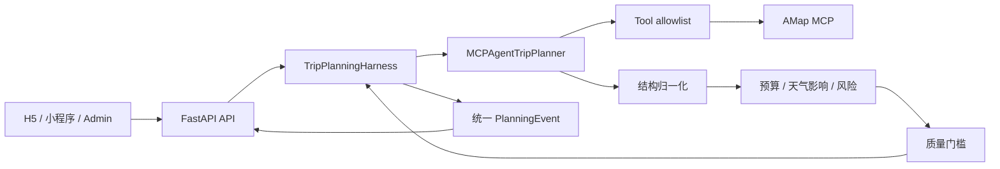

# Agent 与 Harness 重构设计

更新时间：2026-09-02

## 1. 现状判断

当前项目已经从固定 Plan-Execute-Replan 图迁移到高德 MCP ReAct Agent，但迁移只完成了“执行器替换”，还没有完成运行架构收口：

1. `MCPAgentTripPlanner` 同时负责 MCP 启动、工具授权、提示词、Agent 执行、JSON 解析、领域归一化、预算、风险和质量评分，职责过重。
2. `TripPlanningWorkflow` 无法观察 Agent 内部过程，只能在调用前后依次发送预设状态；用户看到的进度不代表真实执行。
3. 工具调用没有形成可审计轨迹，无法证明天气、地点和路线是否真的被查询。
4. API 流式请求、轮询 Job 与同步接口各自处理进度，缺少同一事件协议。
5. Agent 返回 JSON 后直接进入产品响应，缺少“未调用真实工具时阻断输出”的质量门槛。
6. 旧的 `nodes.py`、`graph_state.py`、`tool_executor.py` 仍保留在主包，和新 Agent 形成两套规划心智模型。

## 2. 目标架构



职责边界：

| 层 | 负责 | 不负责 |
| --- | --- | --- |
| Agent | 理解需求、自主选工具、研究地点与路线、生成结构化草案 | 请求线程、SSE、Job 状态、产品进度协议 |
| Harness | run id、线程隔离、事件序号、单调进度、错误传播、最终结果交付 | 旅行领域决策、具体工具参数 |
| 确定性后处理 | 字段归一化、预算、天气影响、风险提示、质量评分 | 自主调用外部工具 |
| API | 校验、响应转换、SSE/HTTP 传输 | 推断 Agent 阶段、伪造执行进度 |
| Client | 展示真实阶段、消息和结果 | 本地模拟后端规划步骤 |

## 3. 统一事件协议

所有同步、SSE 和异步 Job 均消费同一个 `PlanningEvent`：

```json
{
  "run_id": "f44c...",
  "sequence": 4,
  "step": "food_search",
  "message": "已获得沿途餐厅与本地风味",
  "progress": 40,
  "detail": {
    "tool": "maps_text_search",
    "ok": true
  },
  "emitted_at": "2026-09-02T10:30:00+00:00"
}
```

约束：

- `run_id` 在一次规划生命周期内稳定。
- `sequence` 严格递增，客户端可据此去重和排障。
- `progress` 只能单调递增；工具执行顺序可自主变化，但进度不会回退。
- `detail` 只记录工具名、阶段和成功状态，不保存敏感参数或完整工具输出。
- 阶段来自真实 Agent 工具消息与确定性后处理，不由 API 猜测。

## 4. 质量与安全门槛

Agent 工具采用显式 allowlist。当前只开放文本搜索、天气、地址地理编码、地点详情及步行/驾车/公交路线。

一次规划至少满足：

1. 存在成功的 MCP 工具调用。
2. 至少完成一次真实地点搜索。
3. 至少完成一次天气查询。
4. 每日行程存在活动。
5. 活动与候选经过统一坐标、价格和来源归一化。
6. 预算、天气影响和风险提示由确定性代码重新计算，不能完全信任模型字段。

未满足 1-3 时直接中止，不向用户返回未经验证但看似完整的行程。

## 5. UI 边界

小程序现有视觉和信息架构保持不变，Agent/Harness 重构只通过原有阶段 key 更新生成进度，不把运行时概念侵入消费端界面。

H5 继续复用同一套组件和视觉 token，但在桌面宽度下做布局适配：

- 出发地与目的地使用双栏排列。
- 日期区域保持整行，避免横向信息拥挤。
- 人数、预算、住宿与偏好形成不对称双栏，利用桌面空间但不改变字段结构。
- 主操作按钮在桌面端收敛为固定最大宽度；移动端和微信小程序样式不受影响。

管理后台保持原有独立视觉体系和桌面信息密度，不与消费端强行共用品牌表达。

## 6. 后续迁移

本轮保留旧 LangGraph 文件，避免直接删除用户现有实现。确认新 MCP Agent 在生产数据上稳定后，再执行第二阶段清理：

1. 删除不再被入口引用的 `nodes.py`、`graph_state.py` 和旧 planner/replanner prompt。
2. 将长 JSON schema 改为 Pydantic 结构化输出，减少解析失败。
3. 将内存 JobStore 替换为 Redis，支持多进程部署、取消、重试与恢复。
4. 增加 run 级可观测指标：工具耗时、模型 token、失败工具、质量门槛原因。
5. 为 MCP 结果增加短时缓存和并发上限，降低同目的地重复研究的成本。
