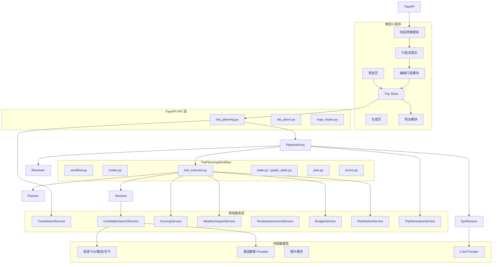
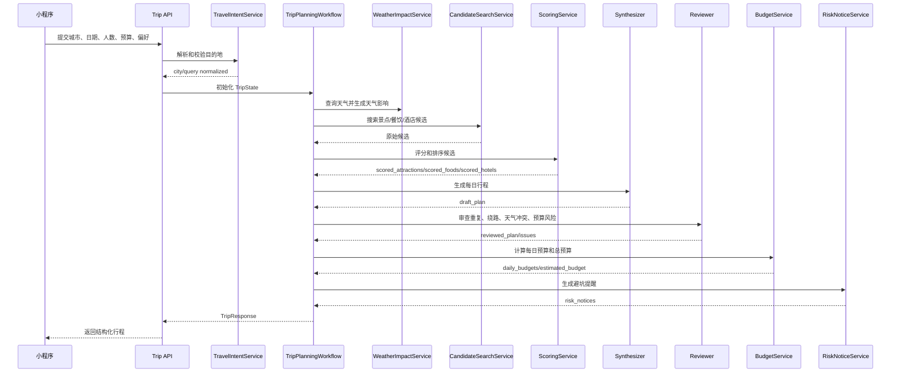

# 随心游智能旅游规划助手详细设计文档

## 1. 文档信息

| 项目 | 内容 |
| --- | --- |
| 文档名称 | 随心游智能旅游规划助手详细设计文档 |
| 输入依据 | `doc/proposal.md` |
| 输出文件 | `doc/detailed-design.md` |
| 设计范围 | 微信小程序 + Python FastAPI 后端 |
| 架构原则 | 固定流水线、模块独立、职责清晰、可观测、可渐进增强 |
| 更新时间 | 2026-06-16 |

## 2. 设计目标

本设计文档用于指导“随心游”从当前 MVP 代码演进为更完整的智能旅游规划助手。设计重点不是推翻现有系统，而是在保留已有合理能力的基础上，将模块边界、数据结构、评分逻辑、天气影响、编辑行程和导出能力设计清楚。

核心目标：

1. 支持国内单城市 1-7 天游。
2. 支持城市、日期、人数、预算、偏好输入。
3. 城市缺失时阻断生成并提示输入城市。
4. 后端生成结构化可执行行程。
5. 推荐候选经过评分和排序。
6. 天气参与行程生成和审查，不只用于展示。
7. 输出每日预算和总预算。
8. 小程序本地支持编辑行程顺序和删除景点。
9. 小程序本地支持导出图片和 PDF。
10. 保持模块独立，降低流水线步骤、工具、评分、预算、天气、导出之间的耦合。

## 3. 总体架构决策

### 3.1 是否继续使用工作流式规划

结论：**正式收敛为 LangGraph `TripPlanningWorkflow` 的 Plan-Execute-Replan 工作流。**

理由：

1. 旅游规划天然是多步骤任务，涉及需求理解、候选搜索、候选评分、天气影响、路线组织、预算估算、结果审查，适合工作流编排。
2. 当前产品更需要稳定、低耗时、可解释的固定链路，而不是让多个模型角色自主路由。
3. 旧 agent/orchestrator/graph 编排层已从源码删除，规划入口统一为 `backend/app/trip_planning/workflow.py`。
4. LLM 仍参与 Planner、Replanner、Finalizer 和交通规划，但工具执行和状态流转由代码显式控制。

需要调整的地方：

1. Executor 负责工具调用和结果写回，候选清洗保留在 `candidates.py`。
2. 推荐去重、展示字段归一化由 `recommendations.py` 负责。
3. 天气影响、预算和风险提醒分别由独立模块负责。
4. 预算估算由 `BudgetService` 统一负责。
5. 质量审查由 `trip_planning/reviewer` 统一负责。
6. API 层只做输入校验、状态构造和响应转换，不承载规划逻辑。

### 3.2 编辑和导出边界

编辑行程和导出能力第一阶段只在小程序本地完成：

1. 后端生成初始行程。
2. 小程序将行程转换为 `Trip` 本地数据结构。
3. 用户点击“编辑行程”后，在本地调整同一天内景点顺序或删除景点。
4. 编辑后的结果更新小程序 store。
5. 导出图片或 PDF 时使用本地最终行程。
6. 第一阶段不要求将编辑操作同步到后端。

这样设计可以避免后端过早引入复杂的行程版本、编辑操作日志和冲突处理。

## 4. 目标模块划分

### 4.1 模块总览



### 4.2 模块职责表

| 模块 | 所属端 | 职责 | 不应承担的职责 |
| --- | --- | --- | --- |
| TravelIntentService | 前后端均可有轻量实现 | 解析城市、识别模糊输入、校验城市必填 | 不生成行程 |
| Trip API | 后端 | 输入校验、调用规划工作流、返回结构化结果 | 不直接写评分、天气、预算规则 |
| Planner | 后端 | 生成查询意图和搜索策略 | 不直接调用所有工具 |
| CandidateSearchService | 后端 | 统一搜索景点、餐饮、酒店候选 | 不决定最终行程 |
| ScoringService | 后端 | 候选评分、排序、解释特征输出 | 不调用 LLM 生成行程 |
| WeatherImpactService | 后端 | 天气分类、天气适配分、调整建议 | 不负责预算 |
| RouteAssessmentService | 后端 | 距离、顺路性、跨区折返评估 | 不负责 POI 搜索 |
| BudgetService | 后端 | 每日预算、总预算、预算风险 | 不负责推荐排序的全部逻辑 |
| Synthesizer | 后端 | 根据候选、评分、天气、预算生成 itinerary | 不重新搜索候选 |
| Reviewer | 后端 | 审查重复、过密、绕路、预算异常、天气冲突 | 不承担主生成 |
| RiskNoticeService | 后端 | 生成避坑提醒 | 不改变行程结构 |
| TripNormalizeService | 后端 | 统一输出结构、补默认值 | 不做业务决策 |
| Trip Store | 小程序 | 保存草稿、当前行程、本地编辑结果 | 不直接调用地图服务 |
| EditTripModule | 小程序 | 本地排序、删除景点、刷新本地预算摘要 | 不调用后端保存编辑 |
| ExportModule | 小程序 | 生成长图/PDF | 不修改行程内容 |

## 5. 后端详细设计

### 5.1 后端目录建议

当前后端已收敛为 `trip_planning`、`services`、`tools`、`domain` 等目录。规划主链路放在 `trip_planning` 包内：

```text
backend/app/
  api/
    trip_planning.py
    trip_plans.py
    map_routes.py
  trip_planning/
    workflow.py
    nodes.py
    state.py
    tool_executor.py
    jobs.py
    errors.py
  services/
    travel_intent.py
    amap_service.py
    map_route_service.py
    tencent_map_service.py
    runtime_config.py
    cache.py
  domain/
    travel_domain.py
  tools/
```

### 5.2 TripPlanningState 设计

当前 `TripPlanningState` 已包含 query、city、days、preferences、budget、candidates、weather、plan 等字段，并支撑评分排序、天气影响、避坑提醒和质量评估。

```python
class TripPlanningState(TypedDict, total=False):
    query: str
    city: str
    departure_city: str
    days: int
    travelers: int
    budget: str
    budget_amount: float
    accommodation_preference: str
    start_date: str
    preferences: list[str]

    query_plan: dict
    weather_data: dict
    weather_impacts: list[dict]

    attraction_candidates: list[dict]
    food_candidates: list[dict]
    hotel_options: list[dict]

    scored_attractions: list[dict]
    scored_foods: list[dict]
    scored_hotels: list[dict]

    transport_plan: dict
    intercity_transport: dict
    draft_plan: list[dict]
    reviewed_plan: list[dict]
    plan: list[dict]

    daily_budgets: list[dict]
    estimated_budget: dict
    risk_notices: list[dict]
    review_issues: list[dict]
    quality_score: dict

    poi_data: dict
    recommendations: list[dict]
    final_output: str
```

当前约束：

1. 请求体使用 camelCase，内部状态使用 snake_case。
2. `budget_amount` 由请求体 `budgetAmount` 转换而来，`budget` 保留为预算档位。
3. `daily_budgets`、`weather_impacts`、`risk_notices` 独立输出，避免塞进普通描述字段。
4. 原始候选和评分后候选分开保存，便于调试和质量评估。

### 5.3 API 设计

#### 5.3.1 规划接口

保留现有接口：

```http
POST /api/trip/planning
```

请求体：

```json
{
  "departureCity": "广州",
  "destination": "深圳",
  "startDate": "2026-05-15",
  "endDate": "2026-05-17",
  "departureTime": "08:00",
  "returnArrivalTime": "20:00",
  "days": 3,
  "travelers": 2,
  "interests": ["classic", "food", "nature"],
  "budgetAmount": 7000,
  "accommodationPreference": "mid-range",
  "additionalRequirements": "深圳海边玩，轻松一点"
}
```

响应体建议演进为：

```json
{
  "plan": "深圳 3 天游摘要文本",
  "itinerary": [
    {
      "day": 1,
      "date": "2026-05-15",
      "theme": "海边与城市休闲",
      "summary": "第一天以轻松适应为主",
      "weather_advice": "天气适合户外，海边安排在上午和傍晚",
      "budget": {
        "total": 780,
        "categories": {
          "food": 180,
          "transportation": 80,
          "tickets": 120,
          "accommodation": 400
        }
      },
      "activities": [
        {
          "id": "act_1_1",
          "time": "09:30",
          "title": "深圳湾公园",
          "location": "深圳湾公园",
          "type": "outdoor",
          "duration": 120,
          "cost_estimate": 0,
          "reason": "符合海边和自然风光偏好，且适合天气较好的上午",
          "score": 86.5,
          "score_factors": {
            "preference": 27,
            "route": 21,
            "poi_quality": 18,
            "weather": 15,
            "budget": 10
          },
          "coordinates": {
            "lat": 22.51,
            "lng": 113.98
          },
          "source": "amap"
        }
      ]
    }
  ],
  "weather": {},
  "weather_impacts": [],
  "estimated_budget": {},
  "daily_budgets": [],
  "recommendations": [],
  "hotels": [],
  "risk_notices": [],
  "quality_score": {},
  "pois": {}
}
```

#### 5.3.2 流式规划接口

保留现有接口：

```http
POST /api/trip/planning/stream
```

SSE 事件建议：

| event | data.step | 说明 |
| --- | --- | --- |
| status | intent_validation | 校验城市、日期、预算 |
| status | request_analysis | 拆解旅行需求 |
| status | weather_lookup | 获取天气并生成天气影响 |
| status | attraction_search | 搜索景点候选 |
| status | food_search | 搜索餐饮候选 |
| status | hotel_search | 搜索住宿候选 |
| status | candidate_scoring | 候选评分排序 |
| status | transport_planning | 评估路线顺路性 |
| status | itinerary_synthesis | 生成每日行程 |
| status | route_grounding | 校准真实地点 |
| status | poi_enrichment | 补全 POI 信息 |
| status | itinerary_review | 审查行程质量 |
| status | budget_estimation | 计算每日和总预算 |
| status | risk_notices | 生成避坑提醒 |
| status | summary | 整理结果 |
| result | - | 返回最终 TripResponse |
| error | - | 返回友好错误 |

#### 5.3.3 行程存储接口

当前已有 `/api/trip/plans` 保存行程。第一阶段编辑只在小程序本地完成，因此后端存储接口不需要支持编辑操作日志。

保留接口：

```http
GET /api/trip/plans
GET /api/trip/plans/{id}
POST /api/trip/plans
PUT /api/trip/plans/{id}
DELETE /api/trip/plans/{id}
```

设计说明：

1. 登录用户可保存 AI 初稿或用户手动保存后的最终行程。
2. 如果未来要保存编辑结果，可复用 `PUT /api/trip/plans/{id}` 直接保存完整 payload。
3. MVP 不新增 `trip_plan_versions` 和 `trip_edit_operations` 表。

## 6. 规划工作流设计

### 6.1 目标流程



### 6.2 工作流节点设计

#### 6.2.1 intent_validation

职责：

1. 校验城市是否存在。
2. 校验天数是否为 1-7。
3. 校验预算是否大于 0。
4. 归一化 query、city、preferences。

失败策略：

1. 无城市：返回 400，提示“请输入目的地城市”。
2. 天数超限：返回 400，提示“当前仅支持 1-7 天游”。
3. 预算非法：返回 400，提示“请输入有效预算”。

#### 6.2.2 weather_tool + weather_impact

建议把天气提前到候选评分前执行。

职责：

1. 根据 city 和 start_date 获取 1-7 天天气。
2. 将天气归类为：晴好、雨天、高温、低温、大风、未知。
3. 输出 `weather_impacts`。
4. 为候选评分提供天气适配信息。

设计原因：

1. 天气需要影响景点排序，例如雨天降低海边、公园、登山权重。
2. 天气需要影响 Synthesizer 的每日活动编排。
3. Reviewer 还需要二次检查天气冲突。

#### 6.2.3 candidate_search

职责：

1. 根据 query_plan 搜索景点、餐饮、酒店。
2. 对外部服务返回做统一字段转换。
3. 保留 source、source_id、coordinates、rating、price、opening_hours 等元数据。

候选标准结构：

```json
{
  "id": "amap_xxx",
  "name": "深圳湾公园",
  "category": "attraction",
  "sub_category": "公园/海边",
  "address": "深圳市南山区",
  "lat": 22.51,
  "lng": 113.98,
  "rating": 4.7,
  "price": 0,
  "opening_hours": "全天",
  "tags": ["自然风光", "海边", "拍照"],
  "source": "amap",
  "raw": {}
}
```

#### 6.2.4 scoring

职责：

1. 对景点、餐饮、酒店分别评分。
2. 输出总分、子分、排序原因。
3. 将评分结果写回 `scored_attractions`、`scored_foods`、`scored_hotels`。

评分结果结构：

```json
{
  "candidate": {},
  "score": 86.5,
  "score_factors": {
    "preference": 27,
    "route": 21,
    "poi_quality": 18,
    "weather": 15,
    "budget": 10
  },
  "reason_tags": ["符合自然风光偏好", "路线顺路", "天气适合户外"],
  "warnings": []
}
```

#### 6.2.5 synthesizer

职责：

1. 只消费已评分候选、天气影响、预算约束和路线评估。
2. 生成每日行程。
3. 为活动填充时间、时长、推荐理由、成本估算。

约束：

1. 不重新发起 POI 搜索。
2. 不生成候选列表之外的核心地点，除非标记为补充建议。
3. 每日活动数量控制在合理范围，建议 3-5 个。
4. 对雨天、高温等天气给出替代安排。

#### 6.2.6 reviewer

职责：

1. 检查地点是否重复。
2. 检查地点是否真实存在。
3. 检查每日行程是否过密。
4. 检查路线是否明显折返。
5. 检查天气冲突。
6. 检查预算是否明显超标。

输出：

```json
{
  "review_issues": [
    {
      "type": "weather_conflict",
      "severity": "medium",
      "message": "雨天安排了较长海边活动",
      "suggestion": "改为室内展馆或缩短户外停留"
    }
  ],
  "quality_score": {
    "total": 82,
    "reality": 90,
    "route": 78,
    "preference": 85,
    "time": 80,
    "budget": 76,
    "explainability": 88
  }
}
```

## 7. 评分服务详细设计

### 7.1 ScoringService 接口

```python
class ScoringService:
    def score_attractions(self, candidates, context) -> list[dict]:
        ...

    def score_foods(self, candidates, context) -> list[dict]:
        ...

    def score_hotels(self, candidates, context) -> list[dict]:
        ...

    def score_itinerary(self, itinerary, context) -> dict:
        ...
```

`context` 包含：

```python
{
    "city": "深圳",
    "preferences": ["classic", "food", "nature"],
    "budgetAmount": 7000,
    "travelers": 2,
    "days": 3,
    "weather_impacts": [],
    "route_context": {}
}
```

### 7.2 景点评分公式

```text
score = preference_score * 0.30
      + route_score * 0.25
      + poi_quality_score * 0.20
      + weather_score * 0.15
      + budget_score * 0.10
```

分值统一归一化为 0-100，再按权重合成。

### 7.3 餐饮评分公式

```text
score = local_feature_score * 0.30
      + route_score * 0.25
      + poi_quality_score * 0.20
      + budget_score * 0.15
      + preference_score * 0.10
```

餐饮不强制区分早餐、午餐、晚餐、夜宵，但 Synthesizer 可以按路线位置把餐饮安排到合适时间段。

### 7.4 酒店评分公式

```text
score = location_score * 0.35
      + budget_score * 0.25
      + poi_quality_score * 0.20
      + route_connection_score * 0.15
      + preference_score * 0.05
```

酒店输出以“住宿区域 + 候选酒店”为主，不承诺库存和实时价格。

### 7.5 推荐理由生成

推荐理由不应完全依赖 LLM 自由发挥，应由评分因素生成基础解释。

规则：

1. 取分值最高的 2-3 个因子。
2. 转换成用户可理解语言。
3. 如存在风险，追加提醒。

示例：

```text
推荐深圳湾公园，因为它符合你的自然风光和海边偏好，且距离当天其他地点较近；如果遇到降雨，建议缩短停留或改到室内点位。
```

## 8. 天气影响服务详细设计

### 8.1 WeatherImpactService 接口

```python
class WeatherImpactService:
    def build_impacts(self, weather_data: dict, start_date: str, days: int) -> list[dict]:
        ...

    def score_candidate_weather_fit(self, candidate: dict, day_weather: dict) -> float:
        ...

    def build_weather_advice(self, day_weather: dict, activities: list[dict]) -> str:
        ...
```

### 8.2 天气影响结构

```json
{
  "date": "2026-05-15",
  "condition_type": "rain",
  "severity": "medium",
  "outdoor_penalty": 30,
  "indoor_boost": 20,
  "advice": "当天有雨，建议减少海边、公园、登山等长时间户外活动。"
}
```

### 8.3 应用阶段

采用两阶段策略：

1. **生成前**：天气影响参与候选评分和排序。
2. **生成后**：Reviewer 检查天气与行程是否冲突，必要时要求重排或给出风险提示。

## 9. 预算服务详细设计

### 9.1 BudgetService 职责

1. 根据用户每人预算、人数、天数计算总预算。
2. 根据行程活动估算每日预算。
3. 输出住宿、餐饮、交通、门票/活动、其他拆分。
4. 识别预算超标风险。

### 9.2 输出结构

```json
{
  "total": 7000,
  "per_person": 3500,
  "per_day": 2333,
  "currency": "CNY",
  "daily_budgets": [
    {
      "day": 1,
      "date": "2026-05-15",
      "total": 2200,
      "categories": {
        "accommodation": 900,
        "food": 400,
        "transportation": 200,
        "tickets": 300,
        "other": 400
      },
      "risk": "normal"
    }
  ],
  "tips": ["预算为估算值，实际消费会受酒店和餐饮价格影响。"]
}
```

### 9.3 小程序转换

当前 `miniapp/src/utils/tripTransform.ts` 只转换整体 `estimated_budget.breakdown`。需要扩展支持：

1. `daily_budgets` 转换到每个 `TripDay.totalCost` 和预算详情。
2. 总预算继续映射到 `Trip.budget.total`。
3. 每日预算可在行程详情页按天展示。

## 10. 避坑提醒服务详细设计

### 10.1 RiskNoticeService 接口

```python
class RiskNoticeService:
    def build_notices(self, state: dict) -> list[dict]:
        ...
```

### 10.2 提醒结构

```json
{
  "type": "weather",
  "level": "medium",
  "title": "雨天户外风险",
  "content": "当天可能有雨，海边和公园建议缩短停留。",
  "related_day": 1,
  "related_place": "深圳湾公园"
}
```

提醒类型：

1. `weather`：天气风险。
2. `opening_hours`：开放时间风险。
3. `reservation`：预约风险。
4. `crowd`：人流风险。
5. `traffic`：交通风险。
6. `budget`：预算风险。

## 11. 前端详细设计

### 11.1 小程序模块划分

建议目录：

```text
miniapp/src/
  pages/
    plan/
    generating/
    trip-detail/
    trip-edit/          # 新增
    trip-export/        # 新增
  stores/
    tripStore.ts
  utils/
    travelIntent.ts
    tripTransform.ts
    tripEdit.ts         # 新增
    tripExport.ts       # 新增
  types/
    trip.ts
  components/
    TripDayCard.vue
    BudgetBars.vue
    WeatherStrip.vue
    RouteMapPreview.vue
    RiskNoticeList.vue  # 新增
```

### 11.2 规划页

当前规划页已具备核心输入能力。需要补充：

1. 城市缺失校验：如果输入无法解析城市，提示“请输入目的地城市”。
2. 天数限制：超过 7 天时提示“当前仅支持 1-7 天游”。
3. 请求 payload 使用 `budgetAmount` 和 `accommodationPreference`。

### 11.3 生成页

当前生成页通过异步任务轮询展示后端进度：

1. 优先调用 `/api/trip/planning/jobs` 启动规划任务。
2. 轮询 `/api/trip/planning/jobs/{job_id}` 展示真实步骤。
2. 如果小程序环境 SSE 支持受限，保留本地进度作为 fallback。
3. 失败时显示明确错误：城市缺失、POI 为空、天气失败、模型超时等。

### 11.4 行程详情页

需要展示：

1. 每日行程。
2. 推荐理由。
3. 每日预算和总预算。
4. 天气建议。
5. 避坑提醒。
6. 推荐住宿区域和候选酒店。
7. 餐饮推荐。
8. “编辑行程”按钮。
9. “导出行程”按钮。

### 11.5 编辑行程模块

编辑只在本地完成。

支持能力：

1. 进入编辑模式。
2. 同一天内调整活动顺序。
3. 删除活动。
4. 保存编辑结果到 `tripStore.currentTrip`。
5. 返回详情页展示编辑后的行程。

不支持：

1. 新增景点。
2. 跨天拖拽。
3. 多人协作。
4. 后端编辑版本记录。

建议工具函数：

```ts
export const moveActivity = (
  trip: Trip,
  dayIndex: number,
  fromIndex: number,
  toIndex: number
): Trip => {}

export const removeActivity = (
  trip: Trip,
  dayIndex: number,
  activityId: string
): Trip => {}

export const recalculateLocalTripSummary = (trip: Trip): Trip => {}
```

### 11.6 导出模块

导出由小程序前端实现。

目标：

1. 导出图片：生成适合手机保存和分享的长图。
2. 导出 PDF：生成适合打印和离线查看的 PDF。
3. 导出内容使用编辑后的最终行程。

导出内容：

1. 城市、日期、人数、预算。
2. 每日行程。
3. 每日预算和总预算。
4. 天气和天气建议。
5. 避坑提醒。
6. 酒店和餐饮推荐。

实现建议：

1. 长图：使用小程序 canvas 绘制导出模板。
2. PDF：第一阶段可使用前端生成多页图片后转 PDF；若小程序 PDF 能力受限，可先生成多张图片并在文档中标记 PDF 为增强能力。
3. 导出前生成预览页，避免用户导出不可读内容。

## 12. 数据结构设计

### 12.1 前端 Trip 类型建议

在当前 `Trip`、`TripDay`、`Activity` 基础上建议扩展：

```ts
export interface Activity {
  id: string
  time: string
  title: string
  description: string
  location: string
  type: ActivityType
  duration: number
  cost: number
  reason?: string
  score?: number
  scoreFactors?: Record<string, number>
  riskNotices?: RiskNotice[]
  coordinates?: { lat: number; lng: number }
}

export interface TripDay {
  date: string
  theme?: string
  summary?: string
  weatherAdvice?: string
  activities: Activity[]
  hotel?: HotelRecommendation
  budget?: DailyBudget
  notes?: string
  totalCost?: number
}

export interface Trip {
  id: string
  destination: string
  startDate: string
  endDate: string
  travelers: number
  interests: string[]
  days: TripDay[]
  weather: WeatherForecast[]
  recommendations: POI[]
  hotels?: POI[]
  budget: BudgetBreakdown
  dailyBudgets?: DailyBudget[]
  riskNotices?: RiskNotice[]
  qualityScore?: QualityScore
  plan?: string
  createdAt: string
  updatedAt: string
}
```

### 12.2 数据库表结构设计

当前后端已有 `User`、`PasswordResetToken`、`TripPlan` 三个 ORM 实体，对应 `users`、`password_reset_tokens`、`trip_plans` 三张表。第一阶段建议继续采用“核心检索字段 + 完整 JSON payload”的混合存储方案，避免过早拆分 `trip_days`、`trip_activities` 等明细表。

这种方案适合当前阶段：

1. 行程结构会随 AI 输出和小程序展示持续迭代。
2. 用户本地编辑不需要后端记录操作日志。
3. 后端查询主要是按用户、目的地、状态、更新时间查行程列表。
4. 完整 payload 便于小程序直接恢复行程详情。

### 12.2.1 users 用户表

来源：`backend/app/models/user.py`

用途：

1. 存储小程序/系统用户账号。
2. 支持登录、保存历史行程、找回密码。

表结构：

| 字段 | 类型 | 约束 | 说明 |
| --- | --- | --- | --- |
| id | CHAR(36) / String(36) | PK | 用户 ID，UUID |
| email | VARCHAR(255) | NOT NULL, UNIQUE, INDEX | 登录邮箱 |
| password_hash | VARCHAR(255) | NOT NULL | 密码哈希 |
| name | VARCHAR(120) | NOT NULL | 用户昵称 |
| avatar_url | VARCHAR(500) | NULL | 用户头像 URL |
| email_verified | TINYINT(1) / Boolean | NOT NULL, DEFAULT 0 | 邮箱是否验证 |
| created_at | DATETIME | NOT NULL | 创建时间 |
| updated_at | DATETIME | NOT NULL | 更新时间 |
| last_login_at | DATETIME | NULL | 最近登录时间 |

索引：

| 索引名 | 字段 | 类型 | 用途 |
| --- | --- | --- | --- |
| PRIMARY | id | 主键 | 用户唯一标识 |
| uq_users_email | email | 唯一索引 | 防止邮箱重复注册 |
| idx_users_email | email | 普通索引 | 登录查询 |

建表 SQL：

```sql
CREATE TABLE IF NOT EXISTS users (
  id CHAR(36) NOT NULL,
  email VARCHAR(255) NOT NULL,
  password_hash VARCHAR(255) NOT NULL,
  name VARCHAR(120) NOT NULL,
  avatar_url VARCHAR(500) NULL,
  email_verified TINYINT(1) NOT NULL DEFAULT 0,
  created_at DATETIME NOT NULL DEFAULT CURRENT_TIMESTAMP,
  updated_at DATETIME NOT NULL DEFAULT CURRENT_TIMESTAMP ON UPDATE CURRENT_TIMESTAMP,
  last_login_at DATETIME NULL,
  PRIMARY KEY (id),
  UNIQUE KEY uq_users_email (email),
  KEY idx_users_email (email)
) ENGINE=InnoDB DEFAULT CHARSET=utf8mb4 COLLATE=utf8mb4_unicode_ci;
```

改造建议：

1. 后台管理复用 `users` 表，通过 `role=admin` 区分管理员账号。
2. 当前阶段不单独设计管理员账号表，避免后台系统过重。
3. MVP 阶段不强制增加用户画像字段，符合 PRD 中“暂不接入用户画像”的边界。

### 12.2.2 password_reset_tokens 密码重置表

来源：`backend/app/models/user.py`

用途：

1. 支持用户找回密码。
2. 存储一次性重置 token 的哈希值、过期时间和使用状态。

表结构：

| 字段 | 类型 | 约束 | 说明 |
| --- | --- | --- | --- |
| id | CHAR(36) / String(36) | PK | 重置记录 ID |
| user_id | CHAR(36) / String(36) | NOT NULL, FK, INDEX | 所属用户 |
| token_hash | CHAR(64) / String(64) | NOT NULL, UNIQUE, INDEX | 重置 token 哈希 |
| expires_at | DATETIME | NOT NULL, INDEX | 过期时间 |
| used_at | DATETIME | NULL | 使用时间，非空表示已使用 |
| created_at | DATETIME | NOT NULL | 创建时间 |

索引：

| 索引名 | 字段 | 类型 | 用途 |
| --- | --- | --- | --- |
| PRIMARY | id | 主键 | 重置记录唯一标识 |
| uq_password_reset_tokens_token_hash | token_hash | 唯一索引 | 根据 token 查找 |
| idx_password_reset_tokens_user_id | user_id | 普通索引 | 查询用户重置记录 |
| idx_password_reset_tokens_expires_at | expires_at | 普通索引 | 清理过期 token |

建表 SQL：

```sql
CREATE TABLE IF NOT EXISTS password_reset_tokens (
  id CHAR(36) NOT NULL,
  user_id CHAR(36) NOT NULL,
  token_hash CHAR(64) NOT NULL,
  expires_at DATETIME NOT NULL,
  used_at DATETIME NULL,
  created_at DATETIME NOT NULL DEFAULT CURRENT_TIMESTAMP,
  PRIMARY KEY (id),
  UNIQUE KEY uq_password_reset_tokens_token_hash (token_hash),
  KEY idx_password_reset_tokens_user_id (user_id),
  KEY idx_password_reset_tokens_expires_at (expires_at),
  CONSTRAINT fk_password_reset_tokens_user
    FOREIGN KEY (user_id) REFERENCES users(id)
    ON DELETE CASCADE
) ENGINE=InnoDB DEFAULT CHARSET=utf8mb4 COLLATE=utf8mb4_unicode_ci;
```

设计说明：

1. 表中只保存 token 哈希，不保存明文 token。
2. token 使用后写入 `used_at`，避免重复使用。
3. 后台管理模块不应展示 token 明文。

### 12.2.3 trip_plans 行程计划表

来源：`backend/app/models/trip_plan.py`

用途：

1. 存储用户保存的行程。
2. 支持历史行程列表、详情查看、更新、删除。
3. 通过核心字段支持列表查询，通过 `payload_json` 保存完整行程结构。

表结构：

| 字段 | 类型 | 约束 | 说明 |
| --- | --- | --- | --- |
| id | CHAR(36) / String(36) | PK | 行程 ID，UUID |
| user_id | CHAR(36) / String(36) | NOT NULL, FK, INDEX | 所属用户 |
| destination | VARCHAR(255) | NOT NULL, INDEX | 目的地城市 |
| start_date | VARCHAR(20) | NOT NULL | 开始日期，格式 `YYYY-MM-DD` |
| end_date | VARCHAR(20) | NOT NULL | 结束日期，格式 `YYYY-MM-DD` |
| travelers | INT | NOT NULL, DEFAULT 1 | 出行人数 |
| interests_json | JSON | NOT NULL | 旅行偏好 |
| budget_total | DECIMAL(12,2) | NOT NULL, DEFAULT 0.00 | 总预算 |
| budget_currency | VARCHAR(10) | NOT NULL, DEFAULT `CNY` | 币种 |
| status | VARCHAR(20) | NOT NULL, DEFAULT `planned`, INDEX | 行程状态 |
| cover_image_url | VARCHAR(500) | NULL | 封面图 URL |
| payload_json | LONGTEXT / Text | NOT NULL | 完整行程 JSON |
| created_at | DATETIME | NOT NULL | 创建时间 |
| updated_at | DATETIME | NOT NULL | 更新时间 |

索引：

| 索引名 | 字段 | 类型 | 用途 |
| --- | --- | --- | --- |
| PRIMARY | id | 主键 | 行程唯一标识 |
| idx_trip_plans_user_id | user_id | 普通索引 | 查询用户行程 |
| idx_trip_plans_destination | destination | 普通索引 | 按目的地筛选 |
| idx_trip_plans_status | status | 普通索引 | 按状态筛选 |

建表 SQL：

```sql
CREATE TABLE IF NOT EXISTS trip_plans (
  id CHAR(36) NOT NULL,
  user_id CHAR(36) NOT NULL,
  destination VARCHAR(255) NOT NULL,
  start_date VARCHAR(20) NOT NULL,
  end_date VARCHAR(20) NOT NULL,
  travelers INT NOT NULL DEFAULT 1,
  interests_json JSON NOT NULL,
  budget_total DECIMAL(12,2) NOT NULL DEFAULT 0.00,
  budget_currency VARCHAR(10) NOT NULL DEFAULT 'CNY',
  status VARCHAR(20) NOT NULL DEFAULT 'planned',
  cover_image_url VARCHAR(500) NULL,
  payload_json LONGTEXT NOT NULL,
  created_at DATETIME NOT NULL DEFAULT CURRENT_TIMESTAMP,
  updated_at DATETIME NOT NULL DEFAULT CURRENT_TIMESTAMP ON UPDATE CURRENT_TIMESTAMP,
  PRIMARY KEY (id),
  KEY idx_trip_plans_user_id (user_id),
  KEY idx_trip_plans_destination (destination),
  KEY idx_trip_plans_status (status),
  CONSTRAINT fk_trip_plans_user
    FOREIGN KEY (user_id) REFERENCES users(id)
    ON DELETE CASCADE
) ENGINE=InnoDB DEFAULT CHARSET=utf8mb4 COLLATE=utf8mb4_unicode_ci;
```

`status` 建议取值：

| 状态 | 说明 |
| --- | --- |
| draft | 草稿 |
| planned | 已生成计划 |
| completed | 已完成出行 |
| archived | 用户归档 |

第一阶段可选增强字段：

| 字段 | 类型 | 说明 |
| --- | --- | --- |
| quality_score_json | JSON | 行程质量评分，可选 |
| generation_run_id | CHAR(36) | 关联一次生成记录 |
| source | VARCHAR(30) | `ai_generated`、`manual`、`imported` |

是否拆分行程明细表：

第一阶段不建议拆分 `trip_days`、`trip_activities`、`trip_hotels`。原因是行程结构仍在快速变化，而且小程序编辑只在本地完成；完整 JSON 保存能降低开发复杂度。等到出现复杂查询需求时再拆分，例如：

1. 后续需要统计热门景点出现次数。
2. 用户要跨行程搜索某个景点。
3. 需要对单个活动做评论、收藏、替换或版本管理。

### 12.2.4 users 用户权限字段增强

后台用户权限不单独设计复杂权限系统，直接在现有 `users` 表增加轻量字段。管理员可以在后台调整普通用户状态、角色和使用额度。

新增字段：

| 字段 | 类型 | 约束 | 说明 |
| --- | --- | --- | --- |
| role | VARCHAR(30) | NOT NULL, DEFAULT `user`, INDEX | 用户角色：`user`、`admin` |
| status | VARCHAR(30) | NOT NULL, DEFAULT `active`, INDEX | 用户状态：`active`、`disabled` |
| daily_plan_limit | INT | NOT NULL, DEFAULT 20 | 每日行程规划次数上限 |
| monthly_plan_limit | INT | NOT NULL, DEFAULT 300 | 每月行程规划次数上限 |

建议 SQL：

```sql
ALTER TABLE users
  ADD COLUMN role VARCHAR(30) NOT NULL DEFAULT 'user',
  ADD COLUMN status VARCHAR(30) NOT NULL DEFAULT 'active',
  ADD COLUMN daily_plan_limit INT NOT NULL DEFAULT 20,
  ADD COLUMN monthly_plan_limit INT NOT NULL DEFAULT 300,
  ADD KEY idx_users_role (role),
  ADD KEY idx_users_status (status);
```

设计说明：

1. `role=admin` 的用户可以登录后台管理页面。
2. `status=disabled` 的用户不能继续调用规划接口。
3. `daily_plan_limit` 和 `monthly_plan_limit` 用于限制规划调用频率。
4. 该方案比单独设计管理员账号表和复杂 RBAC 更轻，适合当前项目阶段。

### 12.2.5 user_daily_usage_stats 用户日活和使用统计表

该表用于后台监控用户日活量、行程规划使用次数和 token 消耗汇总。它是聚合表，可以由登录、打开小程序、发起规划等事件实时更新，也可以通过定时任务从生成记录表汇总。

用途：

1. 统计 DAU。
2. 统计每日行程规划次数。
3. 统计每个用户每日模型 token 消耗和费用。
4. 支持后台按日期查看活跃和使用趋势。

表结构：

| 字段 | 类型 | 约束 | 说明 |
| --- | --- | --- | --- |
| id | CHAR(36) | PK | 统计记录 ID |
| stat_date | DATE | NOT NULL, INDEX | 统计日期 |
| user_id | CHAR(36) | NOT NULL, FK, INDEX | 用户 ID |
| active_count | INT | NOT NULL DEFAULT 0 | 当日活跃次数 |
| plan_count | INT | NOT NULL DEFAULT 0 | 当日行程规划次数 |
| success_plan_count | INT | NOT NULL DEFAULT 0 | 当日成功规划次数 |
| failed_plan_count | INT | NOT NULL DEFAULT 0 | 当日失败规划次数 |
| prompt_tokens | INT | NOT NULL DEFAULT 0 | 当日 prompt token 总量 |
| completion_tokens | INT | NOT NULL DEFAULT 0 | 当日 completion token 总量 |
| total_tokens | INT | NOT NULL DEFAULT 0 | 当日 token 总量 |
| estimated_cost | DECIMAL(12,6) | NOT NULL DEFAULT 0.000000 | 当日预估模型费用 |
| created_at | DATETIME | NOT NULL | 创建时间 |
| updated_at | DATETIME | NOT NULL | 更新时间 |

建议 SQL：

```sql
CREATE TABLE IF NOT EXISTS user_daily_usage_stats (
  id CHAR(36) NOT NULL,
  stat_date DATE NOT NULL,
  user_id CHAR(36) NOT NULL,
  active_count INT NOT NULL DEFAULT 0,
  plan_count INT NOT NULL DEFAULT 0,
  success_plan_count INT NOT NULL DEFAULT 0,
  failed_plan_count INT NOT NULL DEFAULT 0,
  prompt_tokens INT NOT NULL DEFAULT 0,
  completion_tokens INT NOT NULL DEFAULT 0,
  total_tokens INT NOT NULL DEFAULT 0,
  estimated_cost DECIMAL(12,6) NOT NULL DEFAULT 0.000000,
  created_at DATETIME NOT NULL DEFAULT CURRENT_TIMESTAMP,
  updated_at DATETIME NOT NULL DEFAULT CURRENT_TIMESTAMP ON UPDATE CURRENT_TIMESTAMP,
  PRIMARY KEY (id),
  UNIQUE KEY uq_user_daily_usage (stat_date, user_id),
  KEY idx_user_daily_usage_stat_date (stat_date),
  KEY idx_user_daily_usage_user_id (user_id),
  CONSTRAINT fk_user_daily_usage_user
    FOREIGN KEY (user_id) REFERENCES users(id)
    ON DELETE CASCADE
) ENGINE=InnoDB DEFAULT CHARSET=utf8mb4 COLLATE=utf8mb4_unicode_ci;
```

后台 DAU 计算：

```sql
SELECT stat_date, COUNT(DISTINCT user_id) AS dau
FROM user_daily_usage_stats
WHERE active_count > 0
GROUP BY stat_date;
```

### 12.2.6 plan_generation_runs 行程生成和 token 消耗记录表

该表是后台监控行程规划使用次数、模型 token 消耗和费用的核心表。每次用户点击“智能规划”，无论成功或失败，都应创建一条记录。

用途：

1. 记录每次行程规划请求。
2. 统计规划使用次数、成功率、失败率。
3. 记录大模型 prompt token、completion token、total token。
4. 按用户、日期、模型统计 token 和费用。

表结构：

| 字段 | 类型 | 约束 | 说明 |
| --- | --- | --- | --- |
| id | CHAR(36) | PK | 生成记录 ID |
| user_id | CHAR(36) | NULL, INDEX | 登录用户 ID；匿名生成可为空 |
| trip_plan_id | CHAR(36) | NULL, INDEX | 保存后关联的行程 ID |
| city | VARCHAR(255) | NOT NULL, INDEX | 目的地城市 |
| query_text | TEXT | NOT NULL | 用户原始需求 |
| start_date | VARCHAR(20) | NULL | 开始日期 |
| end_date | VARCHAR(20) | NULL | 结束日期 |
| days | INT | NOT NULL | 天数 |
| travelers | INT | NOT NULL | 人数 |
| budget_amount | DECIMAL(12,2) | NOT NULL DEFAULT 0.00 | 用户输入预算金额 |
| preferences_json | JSON | NOT NULL | 偏好 |
| model_provider | VARCHAR(50) | NULL, INDEX | 模型供应商，如 `openai`、`deepseek` |
| model_name | VARCHAR(100) | NULL, INDEX | 模型名称 |
| prompt_tokens | INT | NOT NULL DEFAULT 0 | prompt token |
| completion_tokens | INT | NOT NULL DEFAULT 0 | completion token |
| total_tokens | INT | NOT NULL DEFAULT 0 | token 总量 |
| estimated_cost | DECIMAL(12,6) | NOT NULL DEFAULT 0.000000 | 本次预估费用 |
| status | VARCHAR(30) | NOT NULL, INDEX | `running`、`success`、`failed` |
| error_code | VARCHAR(80) | NULL | 错误码 |
| error_message | TEXT | NULL | 错误信息 |
| latency_ms | INT | NULL | 总耗时 |
| request_json | JSON | NULL | 归一化后的请求 |
| created_at | DATETIME | NOT NULL | 创建时间 |
| updated_at | DATETIME | NOT NULL | 更新时间 |

建议 SQL：

```sql
CREATE TABLE IF NOT EXISTS plan_generation_runs (
  id CHAR(36) NOT NULL,
  user_id CHAR(36) NULL,
  trip_plan_id CHAR(36) NULL,
  city VARCHAR(255) NOT NULL,
  query_text TEXT NOT NULL,
  start_date VARCHAR(20) NULL,
  end_date VARCHAR(20) NULL,
  days INT NOT NULL,
  travelers INT NOT NULL DEFAULT 1,
  budget_amount DECIMAL(12,2) NOT NULL DEFAULT 0.00,
  preferences_json JSON NOT NULL,
  model_provider VARCHAR(50) NULL,
  model_name VARCHAR(100) NULL,
  prompt_tokens INT NOT NULL DEFAULT 0,
  completion_tokens INT NOT NULL DEFAULT 0,
  total_tokens INT NOT NULL DEFAULT 0,
  estimated_cost DECIMAL(12,6) NOT NULL DEFAULT 0.000000,
  status VARCHAR(30) NOT NULL DEFAULT 'running',
  error_code VARCHAR(80) NULL,
  error_message TEXT NULL,
  latency_ms INT NULL,
  request_json JSON NULL,
  created_at DATETIME NOT NULL DEFAULT CURRENT_TIMESTAMP,
  updated_at DATETIME NOT NULL DEFAULT CURRENT_TIMESTAMP ON UPDATE CURRENT_TIMESTAMP,
  PRIMARY KEY (id),
  KEY idx_plan_generation_runs_user_id (user_id),
  KEY idx_plan_generation_runs_trip_plan_id (trip_plan_id),
  KEY idx_plan_generation_runs_city (city),
  KEY idx_generation_runs_model (model_provider, model_name),
  KEY idx_plan_generation_runs_status (status),
  KEY idx_plan_generation_runs_created_at (created_at),
  CONSTRAINT fk_generation_runs_user
    FOREIGN KEY (user_id) REFERENCES users(id)
    ON DELETE SET NULL,
  CONSTRAINT fk_generation_runs_trip_plan
    FOREIGN KEY (trip_plan_id) REFERENCES trip_plans(id)
    ON DELETE SET NULL
) ENGINE=InnoDB DEFAULT CHARSET=utf8mb4 COLLATE=utf8mb4_unicode_ci;
```

费用估算规则：

```text
estimated_cost =
  prompt_tokens / 1000 * prompt_unit_price
  + completion_tokens / 1000 * completion_unit_price
```

其中 `prompt_unit_price`、`completion_unit_price` 来自后台配置表。

### 12.2.7 plan_generation_steps 生成步骤记录表

该表保留为轻量问题排查表，只记录步骤状态、耗时和错误，不再承载复杂运营分析。

用途：

1. 定位规划失败发生在哪个步骤。
2. 统计每个步骤耗时。
3. 辅助后台展示生成过程。

表结构：

| 字段 | 类型 | 约束 | 说明 |
| --- | --- | --- | --- |
| id | CHAR(36) | PK | 步骤记录 ID |
| run_id | CHAR(36) | NOT NULL, FK, INDEX | 所属生成记录 |
| step_key | VARCHAR(80) | NOT NULL, INDEX | 步骤 key |
| step_name | VARCHAR(120) | NOT NULL | 步骤名称 |
| status | VARCHAR(30) | NOT NULL, INDEX | `running`、`success`、`failed` |
| error_message | TEXT | NULL | 错误信息 |
| started_at | DATETIME | NULL | 开始时间 |
| finished_at | DATETIME | NULL | 结束时间 |
| latency_ms | INT | NULL | 耗时 |
| created_at | DATETIME | NOT NULL | 创建时间 |

建议 SQL：

```sql
CREATE TABLE IF NOT EXISTS plan_generation_steps (
  id CHAR(36) NOT NULL,
  run_id CHAR(36) NOT NULL,
  step_key VARCHAR(80) NOT NULL,
  step_name VARCHAR(120) NOT NULL,
  status VARCHAR(30) NOT NULL DEFAULT 'running',
  error_message TEXT NULL,
  started_at DATETIME NULL,
  finished_at DATETIME NULL,
  latency_ms INT NULL,
  created_at DATETIME NOT NULL DEFAULT CURRENT_TIMESTAMP,
  PRIMARY KEY (id),
  KEY idx_generation_steps_run_id (run_id),
  KEY idx_generation_steps_step_key (step_key),
  KEY idx_generation_steps_status (status),
  CONSTRAINT fk_generation_steps_run
    FOREIGN KEY (run_id) REFERENCES plan_generation_runs(id)
    ON DELETE CASCADE
) ENGINE=InnoDB DEFAULT CHARSET=utf8mb4 COLLATE=utf8mb4_unicode_ci;
```

### 12.2.8 app_config_settings 系统配置表

后台需要支持调整模型配置和外部 API 配置。配置项对应后端 `.env` 中的大模型配置和其他 API 配置，但不建议后台直接编辑 `.env` 文件。更稳妥的设计是：

1. `.env` 作为启动默认配置和兜底配置。
2. 后台配置写入 `app_config_settings`。
3. 后端 `ConfigService` 读取数据库配置并覆盖 `.env` 默认值。
4. 对 API Key 等敏感值加密保存，后台只展示掩码。

用途：

1. 调整默认大模型供应商和模型名称。
2. 配置模型 token 单价，用于费用估算。
3. 配置 OpenAI、DeepSeek、Anthropic、Google 等模型 API Key。
4. 配置高德地图、图片服务等外部 API Key。

表结构：

| 字段 | 类型 | 约束 | 说明 |
| --- | --- | --- | --- |
| id | CHAR(36) | PK | 配置 ID |
| config_key | VARCHAR(120) | NOT NULL, UNIQUE | 配置键，如 `DEFAULT_LLM_MODEL` |
| config_value | TEXT | NULL | 配置值，敏感值加密保存 |
| category | VARCHAR(50) | NOT NULL, INDEX | `llm`、`map`、`media`、`system` |
| value_type | VARCHAR(30) | NOT NULL | `string`、`number`、`boolean`、`secret` |
| is_secret | TINYINT(1) | NOT NULL DEFAULT 0 | 是否敏感配置 |
| description | VARCHAR(500) | NULL | 配置说明 |
| updated_by | CHAR(36) | NULL | 最后修改管理员用户 ID |
| created_at | DATETIME | NOT NULL | 创建时间 |
| updated_at | DATETIME | NOT NULL | 更新时间 |

建议 SQL：

```sql
CREATE TABLE IF NOT EXISTS app_config_settings (
  id CHAR(36) NOT NULL,
  config_key VARCHAR(120) NOT NULL,
  config_value TEXT NULL,
  category VARCHAR(50) NOT NULL DEFAULT 'system',
  value_type VARCHAR(30) NOT NULL DEFAULT 'string',
  is_secret TINYINT(1) NOT NULL DEFAULT 0,
  description VARCHAR(500) NULL,
  updated_by CHAR(36) NULL,
  created_at DATETIME NOT NULL DEFAULT CURRENT_TIMESTAMP,
  updated_at DATETIME NOT NULL DEFAULT CURRENT_TIMESTAMP ON UPDATE CURRENT_TIMESTAMP,
  PRIMARY KEY (id),
  UNIQUE KEY uq_app_config_settings_key (config_key),
  KEY idx_app_config_settings_category (category),
  CONSTRAINT fk_app_config_settings_updated_by
    FOREIGN KEY (updated_by) REFERENCES users(id)
    ON DELETE SET NULL
) ENGINE=InnoDB DEFAULT CHARSET=utf8mb4 COLLATE=utf8mb4_unicode_ci;
```

建议支持的配置项：

| config_key | category | value_type | is_secret | 说明 |
| --- | --- | --- | --- | --- |
| DEFAULT_LLM_PROVIDER | llm | string | 0 | 默认模型供应商 |
| DEFAULT_LLM_MODEL | llm | string | 0 | 默认模型 |
| PLANNER_LLM_MODEL | llm | string | 0 | Planner 使用模型 |
| SUMMARY_LLM_MODEL | llm | string | 0 | Summary 使用模型 |
| LLM_TEMPERATURE | llm | number | 0 | 模型温度 |
| LLM_MAX_TOKENS | llm | number | 0 | 最大输出 token |
| OPENAI_API_KEY | llm | secret | 1 | OpenAI Key |
| DEEPSEEK_API_KEY | llm | secret | 1 | DeepSeek Key |
| ANTHROPIC_API_KEY | llm | secret | 1 | Anthropic Key |
| GOOGLE_API_KEY | llm | secret | 1 | Google Key |
| PROMPT_TOKEN_UNIT_PRICE | llm | number | 0 | prompt 每 1K token 单价 |
| COMPLETION_TOKEN_UNIT_PRICE | llm | number | 0 | completion 每 1K token 单价 |
| AMAP_API_KEY | map | secret | 1 | 高德地图 Key |
| UNSPLASH_ACCESS_KEY | media | secret | 1 | 图片服务 Key |

安全要求：

1. `is_secret=1` 的配置必须加密存储。
2. 后台页面只展示掩码，例如 `sk-***abcd`。
3. 后台保存空值时不能覆盖原有 secret，除非用户明确点击“清空配置”。
4. 修改模型/API 配置需要管理员权限。
5. 配置修改后应刷新内存缓存；部分配置如果无法热更新，应提示需要重启服务。

### 12.2.9 表设计阶段划分

| 阶段 | 表 | 是否必须 | 说明 |
| --- | --- | --- | --- |
| MVP | users | 是 | 账号体系 |
| MVP | password_reset_tokens | 是 | 找回密码 |
| MVP | trip_plans | 是 | 保存行程 |
| MVP/P1 | users 权限字段增强 | 建议 | 用户权限、状态、额度 |
| P1 | user_daily_usage_stats | 建议 | DAU、规划次数、token 日汇总 |
| P1 | plan_generation_runs | 建议 | 规划次数、token 和费用监控 |
| P1 | plan_generation_steps | 可选 | 轻量问题排查 |
| P1 | app_config_settings | 建议 | 模型和 API 配置管理 |

## 12.3 后台管理模块设计

### 12.3.1 是否需要后台管理模块

结论：**需要设计一个轻量后台管理模块，但只聚焦监控和配置，不做复杂运营后台。**

原因：

1. AI 规划会产生模型 token 成本，需要监控每次规划的 token 和费用。
2. 需要查看用户日活量、行程规划使用次数，判断产品使用情况。
3. 需要管理用户权限、启停用户、调整用户使用额度。
4. 大模型和外部 API 配置目前依赖 `.env`，上线后需要更方便的后台配置入口。

后台管理不阻塞 C 端规划、编辑、导出 MVP，但建议作为 P1 尽早实现，因为它直接关系到成本控制和系统维护。

### 12.3.2 后台管理模块边界

后台不是复杂运营系统，只做四类事情：

1. 看数据：DAU、规划次数、成功率、失败率。
2. 看成本：每次规划 token、用户累计 token、费用估算。
3. 管用户：用户状态、角色、每日/月度规划额度。
4. 改配置：模型配置、模型 API Key、地图/图片等外部 API 配置。

后台不负责：

1. 替用户规划行程。
2. 人工修改用户本地编辑结果。
3. 做真实交易管理。
4. 管理机票、酒店库存或订单。
5. 复杂内容审核、广告位、运营活动。
6. 多级 RBAC 权限系统。

### 12.3.3 后台功能模块

| 模块 | 优先级 | 功能 |
| --- | --- | --- |
| 管理员登录 | P1 | 使用 `users.role=admin` 登录后台 |
| 数据看板 | P1 | DAU、规划次数、成功率、失败率、平均耗时 |
| Token 监控 | P1 | 每次规划 prompt/completion token、费用估算、用户累计消耗 |
| 用户权限 | P1 | 用户列表、启用/禁用用户、调整每日/月度规划额度 |
| 模型配置 | P1 | 配置默认模型、Planner/Summary 模型、温度、最大 token |
| API 配置 | P1 | 配置 OpenAI/DeepSeek/Anthropic/Google/高德/Unsplash 等 Key |
| 生成记录 | P2 | 查看单次规划状态、错误、耗时和步骤 |

### 12.3.4 后台 API 建议

后台 API 建议与 C 端 API 分离，统一使用 `/api/admin` 前缀。

| 方法 | 路径 | 说明 |
| --- | --- | --- |
| GET | `/api/admin/dashboard/summary` | 数据看板 |
| GET | `/api/admin/dashboard/daily-usage` | 按日期查看 DAU、规划次数、token 和费用 |
| GET | `/api/admin/users` | 用户列表 |
| PATCH | `/api/admin/users/{id}/permission` | 修改用户状态、角色、规划额度 |
| GET | `/api/admin/token-usage` | Token 消耗列表 |
| GET | `/api/admin/token-usage/users/{id}` | 单个用户累计 token 和费用 |
| GET | `/api/admin/generation-runs` | 生成记录列表 |
| GET | `/api/admin/generation-runs/{id}` | 生成记录详情 |
| GET | `/api/admin/configs` | 配置列表 |
| PUT | `/api/admin/configs/{config_key}` | 修改配置 |
| POST | `/api/admin/configs/reload` | 刷新后端配置缓存 |

权限建议：

| 角色 | 权限 |
| --- | --- |
| admin | 可查看监控、调整用户权限、修改模型/API 配置 |
| user | 只能使用 C 端小程序，不能访问后台 |

### 12.3.5 后台与现有系统的关系

后台管理模块依赖以下表：

1. `users`
2. `user_daily_usage_stats`
3. `plan_generation_runs`
4. `plan_generation_steps`
5. `app_config_settings`

其中 `users` 已存在，需要增加权限和额度字段；`plan_generation_runs` 是 token 监控的核心表；`app_config_settings` 用于替代直接编辑 `.env` 的运维方式。

### 12.3.6 实施建议

建议实施顺序：

1. 先扩展 `users` 权限字段，支持 `role=admin`。
2. 新增 `plan_generation_runs`，记录每次规划的 token、费用、状态和耗时。
3. 新增 `user_daily_usage_stats`，支持 DAU 和日维度使用统计。
4. 新增 `app_config_settings`，支持模型/API 配置管理。
5. 后台先做四个页面：数据看板、Token 监控、用户权限、配置管理。
6. `plan_generation_steps` 可在需要排查生成链路时再补。

这样不会引入复杂运营后台，同时能满足成本监控、用户使用监控和配置管理的核心需求。

### 12.4 当前 trip_plans 混合存储方案说明

当前 `trip_plans` 表适合 MVP：

| 字段 | 说明 |
| --- | --- |
| id | 行程 ID |
| user_id | 用户 ID |
| destination | 目的地 |
| start_date/end_date | 日期范围 |
| travelers | 人数 |
| interests_json | 偏好 |
| budget_total | 总预算 |
| status | 行程状态 |
| cover_image_url | 封面图 |
| payload_json | 完整行程 JSON |
| created_at/updated_at | 时间戳 |

建议补充字段：

| 字段 | 类型 | 说明 |
| --- | --- | --- |
| quality_score | Numeric 或 JSON | 行程质量分，可选 |
| source | String | `ai_generated` / `imported` / `manual` |

不建议第一阶段新增：

1. `trip_days`
2. `trip_activities`
3. `trip_edit_operations`
4. `trip_versions`

原因：编辑只在本地完成，后端保存完整 payload 已足够；过早拆表会增加复杂度。

## 13. 现有模块改造建议

### 13.1 API 路由拆分

当前结构：

1. `backend/app/api/trip_planning.py`：规划、异步任务、SSE。
2. `backend/app/api/trip_plans.py`：行程保存、历史、删除。
3. `backend/app/api/map_routes.py`：地图路线接口。
4. `backend/app/api/map_routes.py`：地图路线 polyline 接口。

设计要求：

1. API 层只做 HTTP 输入输出。
2. 请求归一化放在 `trip_planning/state.py`。
3. response 组装放在 `trip_planning/response.py`。
4. 异步任务状态放在 `trip_planning/jobs.py`。

### 13.2 `backend/app/trip_planning/workflow.py`

当前设计目标：

1. 保留 Plan-Execute-Replan 闭环，避免自治编排。
2. Executor 中天气、景点、餐饮、住宿、交通等工具能力按 action 执行。
3. 规划进度通过 SSE 和异步 job service 暴露给小程序。

优化建议：

1. 为每个步骤记录耗时和 provider 错误。
2. 持续压缩候选数量，降低最终整合耗时。
3. 将 response 组装继续保持在 `trip_planning/response.py`。

建议目标流程：

```text
request_analysis
 -> planner
 -> executor
 -> replanner
 -> transport_planning
 -> finalizer
 -> budget_estimation
 -> risk_notices
 -> summary
```

### 13.3 `backend/app/trip_planning/tool_executor.py`

当前问题：

1. Worker 内部不应承担全局排序和最终决策。
2. 评分逻辑分散，不利于解释和调试。

改造建议：

1. Worker 只负责搜索候选和初步清洗。
2. 评分统一交给 `ScoringService`。
3. Candidate 结构统一，避免各步骤输出字段不一致。

### 13.4 `miniapp/src/stores/tripStore.ts`

当前问题：

1. 生成进度主要是本地模拟。
2. 编辑行程和导出状态尚未独立。

改造建议：

1. 增加 `updateCurrentTripLocally(trip)`。
2. 增加编辑相关 action：`moveActivity`、`removeActivity`。
3. 后续接入 SSE 时，将步骤状态从后端事件驱动。

### 13.5 `miniapp/src/utils/tripTransform.ts`

当前问题：

1. 响应转换已承担较多兼容逻辑。
2. 对推荐理由、评分因子、每日预算、避坑提醒支持不足。

改造建议：

1. 增加 `convertDailyBudgets`。
2. 增加 `convertRiskNotices`。
3. 增加 `reason`、`score`、`scoreFactors` 字段映射。
4. 保持转换逻辑纯函数，避免访问 store 或 API。

## 14. 异常和降级设计

| 场景 | 处理方式 |
| --- | --- |
| 城市缺失 | 前端阻断，提示输入城市；后端仍做兜底校验 |
| 天数超过 7 天 | 前端阻断，后端返回 400 |
| POI 数据为空 | 更换关键词重试，仍为空则返回友好错误 |
| 天气查询失败 | 使用未知天气，不阻断生成，但提示出行前确认 |
| 酒店数据为空 | 推荐住宿区域，不强行生成具体酒店 |
| LLM 超时 | 返回“AI 服务响应超时，请稍后重试” |
| 评分数据缺失 | 使用默认中性分，不让单字段缺失导致全链路失败 |
| 导出失败 | 提示用户重试或改为导出图片 |

## 15. 测试设计

### 15.1 后端单元测试

应覆盖：

1. 城市解析：深圳、我想去深圳海边玩、我想去海边玩。
2. 天数校验：1 天、7 天、8 天。
3. ScoringService：偏好匹配、天气惩罚、预算适配。
4. WeatherImpactService：雨天、高温、晴天分类。
5. BudgetService：每日预算和总预算。
6. RiskNoticeService：天气风险、预算风险、开放时间风险。

### 15.2 后端集成测试

应覆盖：

1. `/api/trip/planning` 正常生成。
2. `/api/trip/planning` 无城市失败。
3. 外部 POI 为空时的错误提示。
4. 天气失败时仍可生成行程。

### 15.3 小程序测试

应覆盖：

1. 规划页城市缺失提示。
2. 1-7 天游日期选择。
3. 生成页失败重试。
4. 行程详情显示推荐理由、每日预算、天气建议。
5. 编辑行程排序。
6. 编辑行程删除景点。
7. 导出图片。
8. 导出 PDF 或 PDF 能力降级提示。

## 16. 实施顺序建议

### 阶段一：输入和数据结构收敛

1. 完成城市必填和 1-7 天游校验。
2. 请求体使用 `budgetAmount`。
3. 扩展前后端 TripResponse/Trip 类型。

### 阶段二：评分和天气影响

1. 新增 `ScoringService`。
2. 新增 `WeatherImpactService`。
3. 调整 TripPlanningWorkflow 节点和工具动作顺序。
4. Synthesizer 使用 scored candidates。

### 阶段三：预算和避坑提醒

1. BudgetService 输出每日预算。
2. 新增 RiskNoticeService。
3. 小程序展示每日预算和避坑提醒。

### 阶段四：本地编辑

1. 新增编辑页或编辑模式。
2. 支持同一天内排序。
3. 支持删除活动。
4. 编辑结果写回本地 store。

### 阶段五：导出

1. 设计导出模板。
2. 实现长图导出。
3. 实现 PDF 导出或 PDF 降级方案。
4. 使用编辑后的最终行程导出。

## 17. 关键验收点

1. 输入“我想去海边玩”时，系统提示输入城市。
2. 输入“我想去深圳海边玩”，系统生成深圳行程。
3. 8 天行程被阻断。
4. 推荐景点、餐饮、酒店带评分和理由。
5. 雨天行程减少户外活动或给出明确替代/提醒。
6. 行程展示每日预算和总预算。
7. 用户能删除某个景点。
8. 用户能调整同一天内景点顺序。
9. 导出内容使用编辑后的最终行程。
10. 后端模块之间职责清晰，评分、天气、预算、风险提醒可单独测试。

## 18. 总结

本详细设计建议采用当前已经落地的 `TripPlanningWorkflow` 工作流。它适合旅游规划这种多步骤、多约束、多工具调用的任务，同时比自主编排更可控、更容易压缩耗时。为了让系统具备生产级可维护性，需要将通用决策逻辑持续沉淀为独立的候选清洗、天气影响、预算、风险提醒和标准化模块。

第一阶段后端重点是生成可信、可解释、可评分的结构化行程；小程序重点是让用户能本地编辑和导出最终方案。这样既能利用 AI 的规划能力，又能给用户保留最终控制权，符合“智能旅游规划助手”而不是简单推荐列表的产品定位。
