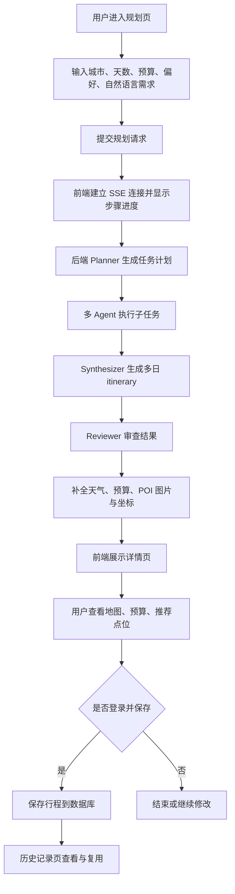
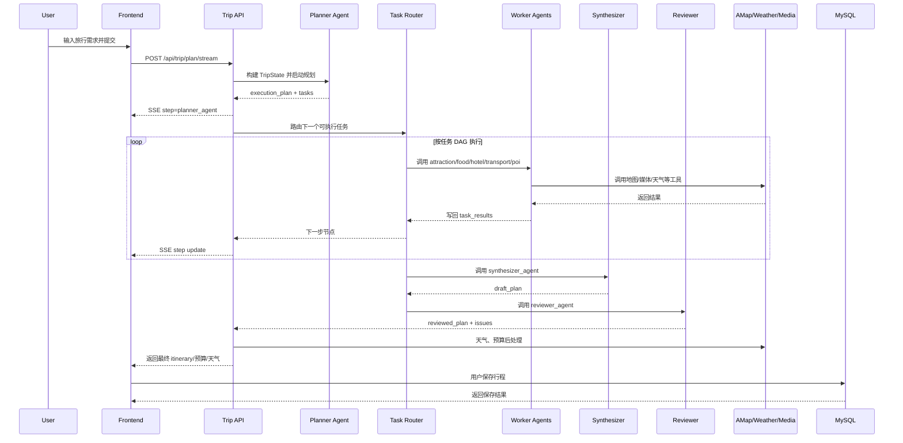
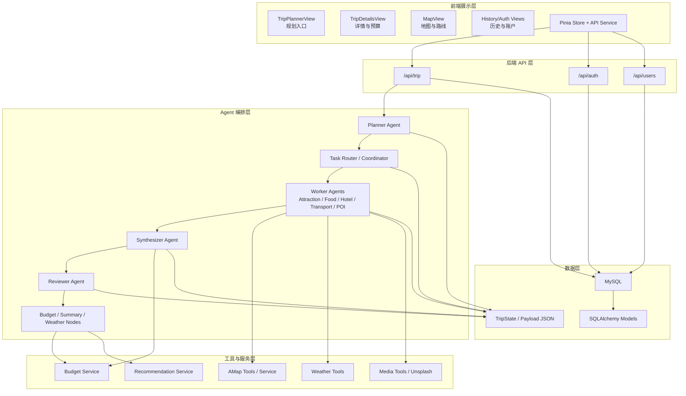
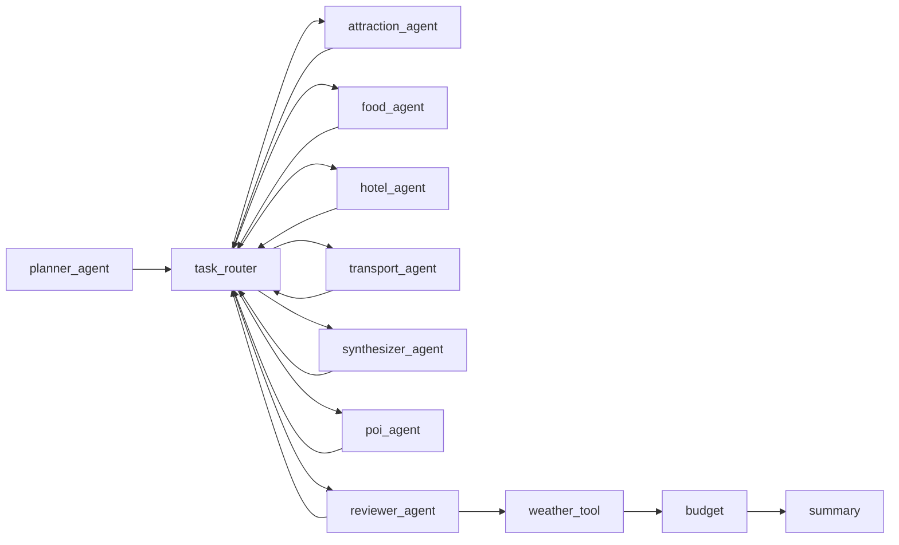
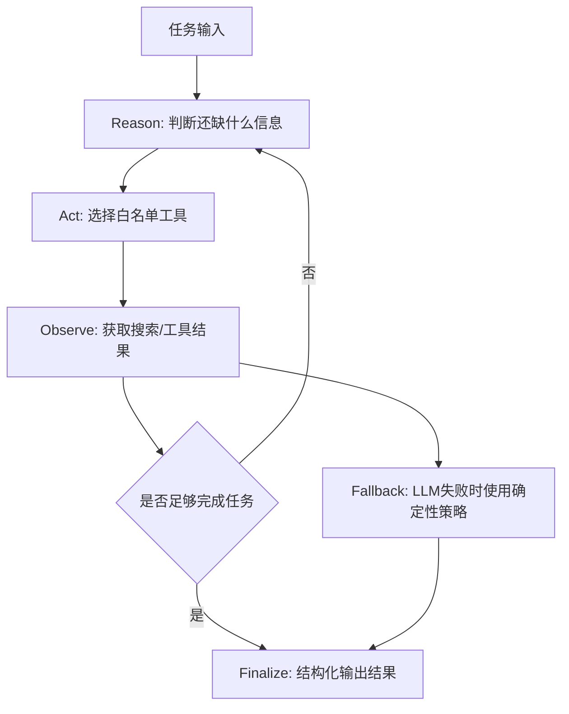
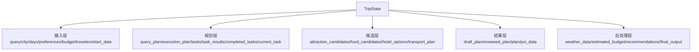
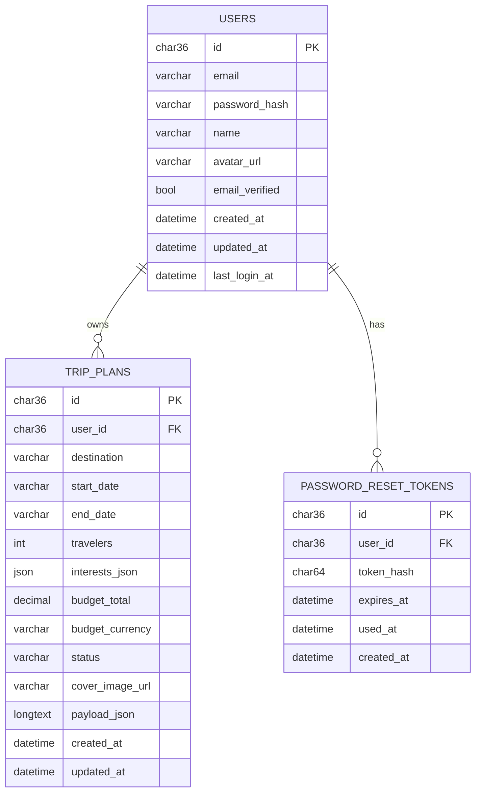
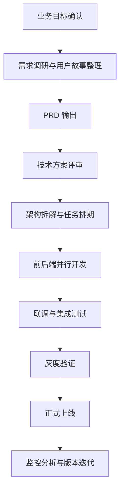

# AI Travel Planner 产品需求与架构设计文档

## 1. 文档信息

| 项目 | 内容 |
| --- | --- |
| 文档名称 | AI Travel Planner 产品需求与架构设计文档 |
| 文档版本 | v2.0 |
| 文档类型 | PRD + 系统架构设计 + 实施方案 |
| 文档状态 | 当前实施版 |
| 适用角色 | 产品、研发、测试、运维、项目管理 |
| 更新时间 | 2026-04-19 |

---

## 2. 项目概述

### 2.1 项目背景

旅游规划天然是一个跨信息源、多约束、多步骤的复杂决策问题。用户通常需要在地图、酒店平台、美食攻略、天气查询、社交媒体和预算工具之间来回切换，最终才能拼出一份勉强可执行的旅行方案。

传统产品的不足主要体现在以下几个方面：

1. 信息聚合能力弱，只能给出碎片化搜索结果，无法形成完整行程。
2. 行程组织能力弱，无法兼顾路线顺序、城市分区、预算和偏好。
3. 结果可信度不稳定，容易出现不本地、重复、跨城错配、预算失真等问题。
4. 用户缺少保存、查看、复用和可视化理解的统一闭环。

AI Travel Planner 的目标不是只做“推荐若干地点”，而是构建一个面向多日旅行的智能规划系统，输出可读、可执行、可视化、可保存的完整旅行计划。

### 2.2 产品定位

本项目定位为：

**面向自由行场景的 AI 驱动旅行规划与地图可视化平台**

其核心能力包括：

1. 理解用户意图并拆分规划任务。
2. 通过多 Agent 完成景点、餐饮、酒店、动线等子任务执行。
3. 汇总成多日 itinerary，并进行质量审查。
4. 在前端以详情页、地图页、历史记录等形式完成交付。

### 2.3 产品目标

#### 业务目标

1. 降低用户从“有旅行想法”到“拿到可用行程”的门槛。
2. 提高旅行计划的可执行性、本地化程度和路线合理性。
3. 建立用户账号与历史行程资产，提升复访与复用。

#### 产品目标

1. 用户一次输入即可生成完整的多日旅行计划。
2. 行程应同时覆盖景点、餐饮、住宿、天气、预算和地图信息。
3. 前端应提供清晰的流式生成过程反馈和结果可视化。
4. 用户可保存、查看、更新、删除自己的行程计划。

#### 技术目标

1. 从固定流水线升级为任务驱动的 Agent 编排架构。
2. 支持 Planner、ReAct Worker、Synthesizer、Reviewer 的分层协作。
3. 在 LLM 不稳定或外部服务异常时保持可回退能力。
4. 支持前后端独立部署，并具备可扩展性与可观测性。

---

## 3. 需求分析

### 3.1 目标用户

| 用户类型 | 核心诉求 | 典型特征 |
| --- | --- | --- |
| 自由行用户 | 快速得到可执行行程 | 追求效率，不想做大量攻略 |
| 家庭/情侣/朋友出游用户 | 兼顾预算、体验、路线 | 需要平衡多人偏好 |
| 攻略参考型用户 | 需要一份高质量草案 | 会二次编辑，但希望有良好起点 |
| 地图理解型用户 | 希望直观看到路线分布 | 对空间感和顺路性敏感 |

### 3.2 典型用户故事

1. 作为一个计划去洛阳玩 3 天的用户，我希望输入预算、兴趣和人数后，快速得到一份覆盖景点、美食和住宿的完整行程。
2. 作为一个带父母出游的用户，我希望系统安排节奏较缓的路线，不要跨区来回折返。
3. 作为一个预算敏感型用户，我希望知道整体预算大约是多少，以及大头花销来自哪里。
4. 作为一个有地图习惯的用户，我希望在地图上看到每天去哪些地方、路线是否顺路。
5. 作为一个登录用户，我希望把满意的行程保存下来，下次继续查看和修改。

### 3.3 核心痛点

1. 缺少“从需求到方案”的完整闭环。
2. 地点推荐容易失真，缺乏城市本地特色。
3. 景点、餐饮、酒店之间缺乏整体组织关系。
4. 预算经常过于模板化，缺少可解释性。
5. 地图只是展示点位，没有形成对行程的理解支持。

### 3.4 核心需求列表

| 编号 | 需求 | 优先级 | 说明 |
| --- | --- | --- | --- |
| R-01 | 支持自然语言输入旅行需求 | P0 | 入口能力 |
| R-02 | 支持输入城市、天数、人数、预算、偏好、出发日期 | P0 | 结构化基础参数 |
| R-03 | 生成多日 itinerary | P0 | 核心结果 |
| R-04 | 输出景点、餐饮、酒店、动线、天气、预算 | P0 | 结果完整性 |
| R-05 | 支持流式步骤展示 | P0 | 增强可感知性 |
| R-06 | 支持地图路线可视化 | P0 | 强化可执行理解 |
| R-07 | 支持账号注册、登录、找回密码 | P1 | 账户体系 |
| R-08 | 支持保存和管理历史行程 | P1 | 资产沉淀 |
| R-09 | 支持结果审查与质量控制 | P1 | 多 Agent 必要机制 |
| R-10 | 支持更稳定的图片来源策略 | P2 | 体验优化 |
| R-11 | 支持并行调度与结果 patch | P2 | 架构升级方向 |

### 3.5 范围边界

#### 本期范围

1. 单城市多日旅行规划。
2. 景点、餐饮、住宿、动线、预算、天气、地图展示。
3. 行程详情查看与历史行程管理。
4. 用户登录、个人资料、密码找回。

#### 非本期范围

1. 机票、火车票、酒店、门票的真实交易闭环。
2. 实时库存、价格监控和价格波动提醒。
3. 多人协作编辑行程。
4. 海外地图引擎自动切换。
5. 商业推荐位和广告系统。

---

## 4. 产品流程设计

### 4.1 用户主流程



### 4.2 生成链路时序图



---

## 5. 总体架构设计

### 5.1 架构原则

1. 先规划再执行，避免单次大模型直接生成全量结果。
2. 多 Agent 分工协作，降低单 Agent 提示词和职责复杂度。
3. 统一状态容器，避免中间结果丢失和模块间隐式耦合。
4. 工具访问收口到 registry，便于扩展和替换供应商。
5. 对外部依赖保持 fallback 设计，确保系统可用性。

### 5.2 系统分层架构图



### 5.3 当前技术栈

| 层级 | 技术 |
| --- | --- |
| 前端 | Vue 3、Vite、Pinia、Tailwind、Axios/EventSource |
| 后端 | FastAPI、LangGraph、Pydantic、SQLAlchemy |
| 数据库 | MySQL 8.0 |
| 地图服务 | 高德地图 JS API + Web Service API |
| 图片服务 | POI 图片 + Unsplash + 前端 SVG fallback |
| AI 模型接入 | 统一 LLM 配置层，支持多供应商切换与 fallback |

### 5.4 当前架构评价

#### 优势

1. 已从固定串行提示词升级为任务驱动的 Agent 工作流。
2. 关键领域能力已拆分，便于逐步增强。
3. 流式接口和状态驱动前端已经与后端编排保持一致。
4. 具备基础的用户系统和行程持久化能力，产品闭环完整。

#### 当前限制

1. 任务调度仍是 DAG 驱动的串行执行，尚未实现真实并行。
2. Reviewer 以检查为主，尚未实现自动 patch 闭环。
3. 行程存储已统一为单一主表设计，降低了读写分叉和数据治理成本。
4. 图片、价格、开放时间等外部信息源仍不够稳定。
5. 预算与路线能力虽然已优化，但仍偏“规划辅助”而非“精确执行”。

---

## 6. Agent 架构设计

### 6.1 设计模式

当前采用的核心模式为：

**Planner + Task Router + ReAct Workers + Synthesizer + Reviewer**

这不是传统单 Agent ReAct，也不是完全自治的并行多 Agent，而是更适合当前工程阶段的受控多 Agent 架构。

### 6.2 Agent 编排图



### 6.3 Agent 职责定义

| Agent | 职责 | 输入 | 输出 |
| --- | --- | --- | --- |
| planner_agent | 理解用户需求，产出 `query_plan`、`execution_plan`、`tasks` | 用户输入、历史偏好 | query_plan、tasks |
| attraction_agent | 搜索景点/街区/人文地标候选 | 城市、偏好、query_plan | attraction_candidates |
| food_agent | 搜索本地餐饮候选并做连锁/重复过滤 | 城市、预算、风格 | food_candidates |
| hotel_agent | 搜索预算和区域匹配的住宿候选 | 城市、预算、人数 | hotel_options |
| transport_agent | 生成基础动线和路线摘要 | 候选点、酒店、城市 | transport_plan |
| synthesizer_agent | 汇总候选，生成多日草案 | attractions、food、hotel、transport | draft_plan |
| poi_agent | 补全坐标、图片、地址、描述等 | draft_plan | poi_data、enriched itinerary |
| reviewer_agent | 检查重复、缺失、节奏和完整性 | enriched itinerary | reviewed_plan、review_issues |

### 6.4 Worker ReAct 模式

Attraction、Food、Hotel 当前采用受控 ReAct Worker 模式。



约束规则：

1. 有最大步数限制。
2. 工具调用在白名单内。
3. 结果输出必须结构化。
4. LLM 失败时自动降级到确定性策略。

### 6.5 Task 模型设计

当前任务模型在编排层中承担核心作用，典型字段如下：

| 字段 | 说明 |
| --- | --- |
| task_id | 任务唯一标识 |
| step | 前端流式步骤名 |
| agent | 执行该任务的 agent 名 |
| title | 任务标题 |
| goal | 任务目标 |
| depends_on | 依赖的前置任务 |
| status | `pending/running/completed/failed` |
| inputs | 当前任务输入 |
| result | 当前任务结果 |
| error | 错误信息 |

### 6.6 当前 Agent 设计问题与优化建议

#### 问题 1：串行执行导致生成耗时增长

现状：当前虽然是多 Agent，但执行顺序仍是串行。

建议：

1. 将 attraction、food、hotel 设计为可并行执行的第一批任务。
2. 将 transport 放在第二批依赖任务。
3. 将 reviewer 后置保留，但支持 patch 模式。

#### 问题 2：Synthesizer 与 Reviewer 的边界还可以更清晰

现状：Synthesizer 负责整合，Reviewer 负责检查，但缺少“审查失败后的回写策略”。

建议：

1. Reviewer 输出 issue list + patch plan。
2. 严重问题回退到 Synthesizer 重组。
3. 一般问题由 Reviewer 直接 patch。

#### 问题 3：工具层与供应商适配还不够抽象

现状：地图、图片、天气已经有工具封装，但供应商切换策略和异常兜底文档化不足。

建议：

1. 增加 provider adapter 抽象。
2. 明确图片优先级和可用性降级路径。
3. 为 route/weather/media 增加监控指标。

---

## 7. 模块设计

### 7.1 代码目录设计

```text
backend/app/
  agents/
    planner/
    workers/
    synthesizer/
    reviewer/
  api/
  orchestration/
  tools/
  services/
  graph/
  models/
  core/

frontend/src/
  views/
  components/
  stores/
  services/
  router/
```

### 7.2 后端模块职责

| 模块 | 说明 |
| --- | --- |
| `app/api` | 提供 trip、auth、users 接口 |
| `app/agents/planner` | Planner 提示词与规划输出 |
| `app/agents/workers` | 各领域 worker 与 ReAct 基类 |
| `app/agents/synthesizer` | 多候选结果合成 itinerary |
| `app/agents/reviewer` | 审核与修复建议 |
| `app/orchestration` | task model、task router、coordinator |
| `app/tools` | 面向 Agent 的工具注册与适配 |
| `app/services` | 底层业务服务，如高德、预算、图片 |
| `app/graph` | LangGraph 节点编排、State 定义 |
| `app/models` | ORM 数据模型 |
| `app/core` | 配置、数据库、安全、LLM 等基础设施 |

### 7.3 前端模块职责

| 模块 | 说明 |
| --- | --- |
| `TripPlannerView.vue` | 旅行输入与启动规划 |
| `TripDetailsView.vue` | 多日详情、预算、推荐内容展示 |
| `MapView.vue` | 地图、点位、路线、图例、错误提示 |
| `History` 相关页面 | 历史行程管理 |
| `Auth` 相关页面 | 登录、注册、找回密码 |
| `stores/tripStore.ts` | 当前行程状态、SSE 进度、前端数据格式转换 |
| `services/api.ts` | 后端 API 调用、SSE 事件处理 |

---

## 8. 功能设计

### 8.1 规划输入模块

#### 功能目标

让用户在最短输入路径下表达旅行需求。

#### 输入字段

| 字段 | 必填 | 说明 |
| --- | --- | --- |
| 城市 | 是 | 目的地城市 |
| 天数 | 是 | 旅行天数 |
| 自然语言需求 | 是 | 旅行意图和附加偏好 |
| 偏好标签 | 否 | 如人文、美食、休闲 |
| 预算 | 否 | 经济/中等/豪华或前端预算映射 |
| 人数 | 否 | 默认 1 |
| 出发日期 | 否 | 用于天气和日期展示 |

#### 校验规则

1. 城市不能为空。
2. 旅行需求不能为空。
3. 天数必须大于 0 且小于系统最大限制。

### 8.2 流式规划模块

#### 功能目标

让用户感知系统正在做什么，降低等待焦虑。

#### 当前流式步骤

1. `planner_agent`
2. `attraction_agent`
3. `food_agent`
4. `hotel_agent`
5. `transport_agent`
6. `synthesizer_agent`
7. `poi_agent`
8. `reviewer_agent`
9. `weather_tool`
10. `budget`
11. `summary`

#### 前端体验要求

1. 步骤名称用户可理解。
2. 当前步骤高亮。
3. 失败时返回友好提示，不暴露内部异常栈。

### 8.3 行程详情模块

#### 功能目标

将复杂的 itinerary 转换为用户可快速理解的日程视图。

#### 输出内容

1. 每日活动列表。
2. 活动标题、时间、地点、描述、类型、费用。
3. 推荐酒店。
4. 推荐地点。
5. 天气信息。
6. 预算估算及明细。

### 8.4 地图模块

#### 功能目标

帮助用户从空间视角理解行程可执行性。

#### 当前能力

1. 展示活动点位。
2. 按天绘制路线。
3. 标记当天起点和终点。
4. 支持标准图/卫星图切换。
5. 支持自动 fit view。
6. 支持路线图例与汇总信息展示。
7. 支持产品化地图错误提示。

#### 地图错误提示设计原则

1. 面向用户，避免技术噪音。
2. 对配置错误和临时失败做区分。
3. 不在页面直接暴露平台内部错误码。

### 8.5 行程管理模块

#### 功能目标

为用户沉淀可复用的旅行资产。

#### 功能点

1. 保存行程。
2. 查询行程列表。
3. 查看单个行程详情。
4. 更新行程。
5. 删除行程。

### 8.6 用户与认证模块

#### 功能点

1. 注册。
2. 登录。
3. 获取当前用户。
4. 更新用户昵称和头像。
5. 忘记密码。
6. 重置密码。

### 8.7 预算估算模块

#### 功能目标

给出可解释、非模板化的预算结果。

#### 预算来源优先级

1. 酒店价格。
2. 活动门票或消费价格。
3. 餐饮估算。
4. 交通估算。
5. 购物/浮动项比例。

#### 输出结构

1. 总预算。
2. 人均预算。
3. 分类预算明细。
4. 文本化说明。

### 8.8 图片策略模块

#### 当前优先级

1. POI 自带图片。
2. Unsplash 图片。
3. 前端 SVG fallback。

#### 后续建议

1. 增加官方文旅图片源适配。
2. 引入更多公共版权图库 provider。
3. 不建议直接依赖非官方小红书抓取作为主链路。

---

## 9. 接口设计

### 9.1 后端接口总览

| 分类 | 方法 | 路径 | 说明 |
| --- | --- | --- | --- |
| 行程规划 | POST | `/api/trip/plan` | 同步生成结果 |
| 行程规划 | POST | `/api/trip/plan/stream` | SSE 流式生成 |
| 行程管理 | GET | `/api/trip/plans` | 查询行程列表 |
| 行程管理 | GET | `/api/trip/plans/{plan_id}` | 查询单个行程 |
| 行程管理 | POST | `/api/trip/plans` | 新建/覆盖保存行程 |
| 行程管理 | PUT | `/api/trip/plans/{plan_id}` | 更新行程 |
| 行程管理 | DELETE | `/api/trip/plans/{plan_id}` | 删除行程 |
| 天气 | GET | `/api/trip/weather` | 获取天气 |
| POI | GET | `/api/trip/pois/search` | 搜索地点 |
| 推荐 | GET | `/api/trip/recommendations` | 获取推荐内容 |
| 预算 | POST | `/api/trip/budget/estimate` | 预算估算 |
| 路线 | POST | `/api/trip/route/optimize` | 路线优化 |
| 路线 | POST | `/api/trip/route/calculate` | 路径计算 |
| 健康检查 | GET | `/api/trip/health` | 服务健康状态 |
| 认证 | POST | `/api/auth/register` | 注册 |
| 认证 | POST | `/api/auth/login` | 登录 |
| 认证 | GET | `/api/auth/me` | 当前用户 |
| 认证 | POST | `/api/auth/forgot-password` | 忘记密码 |
| 认证 | POST | `/api/auth/reset-password` | 重置密码 |
| 用户 | GET | `/api/users/me` | 获取用户资料 |
| 用户 | PUT | `/api/users/me` | 更新用户资料 |

### 9.2 `POST /api/trip/plan/stream` 设计说明

#### 请求体

```json
{
  "query": "想去洛阳玩三天，偏人文和美食，预算中等",
  "city": "洛阳",
  "days": 3,
  "preferences": ["人文", "美食"],
  "budget": "中等",
  "travelers": 2,
  "start_date": "2026-05-01"
}
```

#### SSE 事件

1. `status`：步骤更新。
2. `result`：最终结果。
3. `error`：规划失败。

### 9.3 接口设计建议

1. 后续应统一返回 `code/message/data` 标准格式。
2. SSE 事件体建议统一包含 `step/status/message/progress` 字段。
3. 建议补充 trace_id 用于排查规划链路问题。

---

## 10. 状态设计

### 10.1 TripState 结构图



### 10.2 TripState 关键字段

| 字段 | 说明 |
| --- | --- |
| `query` | 原始用户需求 |
| `city` | 目标城市 |
| `days` | 旅行天数 |
| `preferences` | 偏好列表 |
| `budget` | 预算等级 |
| `travelers` | 出行人数 |
| `query_plan` | Planner 生成的结构化查询计划 |
| `execution_plan` | Planner 生成的全局执行计划 |
| `tasks` | 当前任务列表 |
| `task_results` | 各任务执行结果 |
| `completed_tasks` | 已完成任务 |
| `current_task` | 当前任务 |
| `attraction_candidates` | 景点候选 |
| `food_candidates` | 餐饮候选 |
| `hotel_options` | 酒店候选 |
| `transport_plan` | 动线摘要 |
| `draft_plan` | Synthesizer 产出的草案 |
| `reviewed_plan` | Reviewer 审查后的结果 |
| `plan` | 最终 itinerary |
| `poi_data` | POI 坐标、图片、描述等 |
| `weather_data` | 天气信息 |
| `estimated_budget` | 预算结果 |
| `final_output` | 文本总结 |

---

## 11. 数据库设计

### 11.1 数据库选型

数据库使用 MySQL 8.0，ORM 使用 SQLAlchemy，当前 schema 文件位于 `backend/schema.sql`。

### 11.2 ER 图



### 11.3 表设计说明

#### `users`

用于存储用户账号和基础资料，是认证与行程归属的根表。

#### `password_reset_tokens`

用于密码找回流程，存储 token 哈希、过期时间、使用时间。

#### `trip_plans`

`trip_plans` 是当前唯一的行程主存储表，采用“结构化摘要字段 + 完整 JSON 快照”的设计：

1. 结构化字段承担查询、过滤、排序和列表展示职责。
2. `payload_json` 保存完整 itinerary 快照，保证前端读写简单、回显稳定。
3. 同一份数据只维护一个真相源，避免多表写入一致性问题。

### 11.4 当前数据库设计问题

#### 问题 1：缺少 Agent 任务日志表

建议新增：

1. `trip_generation_jobs`
2. `trip_generation_tasks`
3. `trip_generation_events`

用于记录规划链路、步骤耗时、失败原因和模型调用情况。

---

## 12. 非功能需求

### 12.1 性能要求

1. 普通 3 日城市规划在可接受时间内返回结果。
2. SSE 应尽快返回首个步骤，避免长时间白屏等待。
3. 地图渲染和切图操作应保持流畅。

### 12.2 稳定性要求

1. 外部图片、地图、模型、天气异常时应有兜底。
2. 规划失败时应返回友好提示。
3. 关键接口应具备超时和重试控制。

### 12.3 安全要求

1. 密码必须存储哈希而非明文。
2. 前后端地图 key 应按平台隔离。
3. 用户只能访问自己的行程数据。
4. 密码找回 token 必须具备过期和一次性使用机制。

### 12.4 可观测性要求

1. 记录每个规划请求的 trace_id。
2. 记录 Agent 步骤耗时和失败原因。
3. 记录外部 API 错误分类。
4. 记录前端关键失败路径，如地图初始化失败。

---

## 13. 测试策略

### 13.1 测试分层

| 层级 | 目标 |
| --- | --- |
| 单元测试 | 验证工具函数、预算逻辑、任务路由逻辑 |
| Agent 测试 | 验证 planner/worker/synthesizer/reviewer 输出稳定性 |
| 接口测试 | 验证 trip/auth/users 接口正确性 |
| 集成测试 | 验证多 Agent 链路是否贯通 |
| 前端测试 | 验证页面交互、SSE 进度、地图异常提示 |
| E2E 测试 | 验证从输入到查看结果再到保存的完整链路 |

### 13.2 关键测试场景

1. 不同城市输入是否会产出符合城市特征的餐饮和景点。
2. 不同预算档位是否会显著影响酒店和预算估算结果。
3. 地图 key 缺失、key 平台不匹配、安全码缺失时是否提示友好。
4. LLM 调用失败时系统是否能 fallback。
5. 保存后的行程是否可正确回显。

---

## 14. 项目风险与优化建议

### 14.1 当前主要风险

| 风险 | 表现 | 影响 |
| --- | --- | --- |
| 外部依赖不稳定 | 地图、模型、图片接口波动 | 结果不稳定 |
| 数据源质量参差 | 错误推荐、重复推荐、本地化不足 | 用户信任下降 |
| 任务串行执行 | 耗时增加 | 体验下降 |
| 审查能力不足 | 局部合理但全局混乱 | 计划质量下降 |

### 14.2 优化路线图

#### 第一阶段：稳定性优化

1. 补充 trace_id 和任务日志。
2. 强化 reviewer 规则。
3. 补充关键接口测试和异常监控。

#### 第二阶段：质量优化

1. 增强城市知识和候选过滤规则。
2. 优化图片 provider 策略。
3. 增强预算解释能力和路线细化能力。

#### 第三阶段：架构升级

1. 实现 attraction/food/hotel 并行调度。
2. 引入 job/task/event 持久化。
3. 让 reviewer 具备 patch 能力。

---

## 15. 项目实施流程建议

### 15.1 需求到上线流程



### 15.2 推荐实施顺序

1. 先稳定规划主链路和数据质量。
2. 再补充可观测性、测试和数据库治理。
3. 最后推进并行化和智能 patch 等高阶能力。

---

## 16. 结论

AI Travel Planner 当前已经具备一个真实可运行项目的基础形态：

1. 产品层面具备完整的规划、查看、保存、地图和账户闭环。
2. 技术层面已从固定流水线升级为任务驱动的多 Agent 架构。
3. 工程层面已有 API、数据库、前端状态、流式步骤和基础异常处理。

但从“可运行”走向“可规模化迭代”，还需要解决三个核心问题：

1. 将当前串行多 Agent 升级为更高效的并行任务编排。
2. 继续增强行程结构化字段和日志体系，提升查询与可观测能力。
3. 强化 Reviewer、监控和测试体系，提升结果质量稳定性。

本文件既可作为当前版本的产品与架构说明，也可作为后续版本规划、研发拆解和评审的基线文档。
